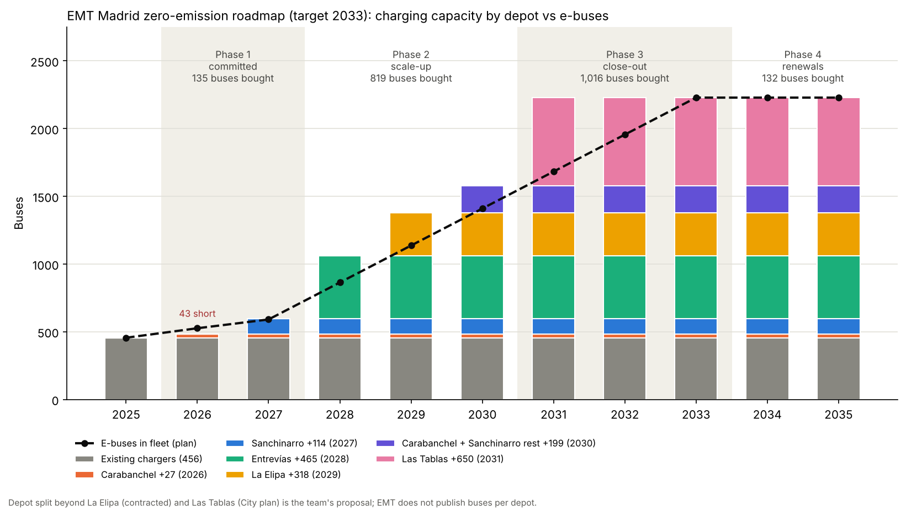

# EMT Madrid – Zero-Emission Fleet Financial Model

Documentation of the financial model built for the IEU Sustainability Datathon (EMT Madrid bus electrification challenge, proposed by Kearney). It describes every sheet, every input variable, how the outputs are calculated, and where each number comes from.

- **Source workbook:** Claude Sheet "EMT Madrid – Financial Baseline 2023–2027" (https://claude.ai/artifact/Pr5MWpCHY2Naa2MXHhuZRk). It's private until shared with the team.
- **Snapshot:** workbook revision 13, 23 November 2026.
- **Discounted view (26 Nov 2026):** section 4.4 adds a 2026-40 discounted comparison of three paths. It is computed outside the workbook and changes no revision 13 figure.
- **Which values the notebooks use (D9, 24 Nov 2026):** notebook 04 §10 runs this model at revision 13 exactly as documented here; the pitch and the report quote it. File 4 (notebook 01) keeps its own conventions, listed in section 0.
- **Units:** € millions (€M), excluding VAT, unless a row says otherwise. Bus prices are in € thousands (€k).
- **Data types used below:**
  - **Official**: taken directly from an EMT, City of Madrid, Comunidad de Madrid, EIB or tender document.
  - **Calculated**: our arithmetic on official figures.
  - **Assumption**: team assumption with no direct source. Challenge these first.
  - **Brief**: fixed parameter set by the datathon brief.

**Files in the repo**

| Path | What it is |
|---|---|
| `notes/financial-model.md` | This document |
| `data/financial_model/roadmap_charging_by_depot.csv` | Year-by-year e-buses, purchases and charging capacity per depot (target 2033) |
| `scripts/plot_roadmap_charging.py` | Redraws the roadmap chart from the CSV (`python scripts/plot_roadmap_charging.py`, needs pandas and matplotlib) |
| `figures/roadmap_charging_by_depot.png` | The roadmap chart (output of the script) |

---

## 0. Revision 13 and File 4 (D9, 24 Nov 2026)

Notebook 04 §10 runs this model at revision 13 as documented (check: EUR 1,943.5M and 100 % in 2033), and every stress test, leasing case and deck figure there uses it. File 4 cannot take revision 13's values: the brief fixes File 4's capex in constant 2025 euros, so the 2 %/yr price growth cannot enter it, and takes the fleet from the register, which gives 2,210 buses. File 4's conventions (D1–D4) are therefore run in notebook 04 §10.3 as a comparison only.

| Input | Revision 13 (this note, notebook 04 §10) | File 4 (notebook 01) |
|---|---|---|
| Fleet at end 2025 | 2,239 (EMT accounts: 456 / 10 / 1,773) | 2,210 (fleet register: 452 / 10 / 1,748) |
| E-bus life / renewals 2031–35 | 12 years / 329 | 13 years / 174 |
| Bus prices | +2 %/yr growth | constant 2025 EUR |
| EU grants on depot works | 20 % | none |
| E-buses added 2026 / 2027 | 70 / 65 | 70 / 65 |
| Charger cost per position | EUR 110k | EUR 110k |

**Same cases on both (notebook 04 §10.3):**

| Case | Revision 13 | File 4 conventions |
|---|---|---|
| Model as built (2033 target, no limits): programme capex 2026–35 | EUR 1,943.5M, peak EUR 312.6M (2028) | EUR 1,696.6M |
| Likely capacity, no delays (230 buses/yr, EUR 150M/yr borrowing): 100 % year | 2037 (EUR 1,684.6M to 2035) | 2037 |
| Most realistic (likely capacity plus 1-year depot slips): 100 % year | **2038** | 2037 |
| Interest in 2035, most realistic case | EUR 38.1M; EUR 49.6M at +1 pt | EUR 36.9M |
| EU grants at 0 instead of 20 %, most realistic case | Same 100 % year (2038); interest EUR 39.5M | — |

**File 4 and the three dates (notebook 01 §8, round 2, 24 Nov 2026).**

- **D8, no gas purchases.** Neither File 4 scenario buys a gas bus: no gas-bus order for 2026 or later is evidenced, and EMT's 2026 and 2027 budgets buy e-buses only. A worn gas bus keeps running until an e-bus replaces it. S0 and S1 are now identical in 2026.
- **Effect on File 4.** S0 capex 2026–35 is EUR 1,390.6M (was 1,367.8M) and S0 reaches 94.9 % in 2035 (was 92.4 %): without the 55 gas buses of 2026, older gas buses reach 13 years sooner and are replaced by e-buses from 2030. S1 is EUR 1,471.8M, unchanged. S1 minus S0: EUR 81.2M and 341.7 kt of CO₂ avoided, about EUR 238 per tonne (grid reinforcement excluded, nothing discounted).
- **Three dates.** 2030 is not achievable (650 e-buses without a charging position). 2033 is the earliest credible year (about 285 e-buses a year from 2028, renewals included, and Las Tablas finished by 2031). If purchases stay at 165–200 a year, 100 % comes in 2037–2040 with gas buses running to about 17 years. On File 4's 13-year renewals, S0 reaches 100 % in 2036, with purchases peaking at 382 a year (2031).
- **Notebook 04 §10** (this model, revision 13): the most realistic case (230 buses a year, EUR 150M a year of borrowing, one-year slips) gives 2038, inside that range.

---

## 1. How the model fits together


| Sheet | Role | Main question it answers |
|---|---|---|
| Roadmap 2026-2035 | Main output | How many e-buses per year, what it costs, and whether depots can charge them |
| Assumptions | All inputs | What do we assume, and what is it based on? |
| Depots & grid | Infrastructure plan | Which depot projects, when, at what cost, how much grid capacity |
| Funding plan | Financing | Who pays: EMT cash, EU grants, EIB loans, green bonds |
| P&L & OPEX | Historical baseline | What EMT spends and earns today |
| CAPEX | Historical baseline | What EMT invested in 2023-2027 |
| Cash flow & financing | Historical baseline | Cash flows, sources/uses of capital, debt, external funders |
| Gaps & sources | Documentation | What data is missing; every source link |

**Scenario switch:** `Assumptions!B2` (target year). Set it to 2030 (100 % forced in 2030; not File 4's S1), 2033 (City/EMT goal) or 2035, and every forecast sheet recalculates.

---

## 2. Input variables (sheet `Assumptions`)

Suggested `snake_case` names make it easy to mirror these in the notebooks (for example in a `config/financial_assumptions.yaml`).

| Variable | Cell | Value | Unit | Type | Source / basis |
|---|---|---|---|---|---|
| `target_year` | B2 | 2033 | year | Scenario | 2030 = 100 % forced in 2030 (not File 4's S1); 2033 = City/EMT goal; 2035 = slow case |
| `fleet_total` | B3 | 2,239 | buses | Official | EMT 2025 accounts: 456 electric + 10 hydrogen + 1,773 CNG. CRTM quotes 2,215. **File 4: 2,210 (D1, section 0)** |
| `h2_buses` | B4 | 10 | buses | Official | EMT 2025 accounts |
| `ebuses_2025` | B5 | 456 | buses | Official | EMT 2025 accounts |
| `ebuses_added_2026` | B6 | 70 | buses | Official | EMT 2026 budget (€47.7M) |
| `ebuses_added_2027` | B7 | 65 | buses | Official (press) | EMT 2027 draft budget, reported by ECOticias (€34.3M) |
| `price_ebus_12m_keur` | B8 | 615 | €k | Official | Max price per bus, 2026-27 tender (Irizar €30.75M/50; Mercedes €24.6M/40) |
| `price_ebus_18m_keur` | B9 | 800 | €k | Official | Solaris articulated, 2026-27 tender (€24M/30). Max price |
| `artic_share` | B10 | 8% | % | Assumption | Share of articulated buses in purchases |
| `price_escalation` | B11 | 2% | %/yr | Assumption | Nominal bus price growth. **File 4: 0 (constant 2025 EUR)** |
| `price_cng_bus_keur` | B12 | 291 | €k | Calculated | €151.5M ÷ 520 CNG buses (2021-23 award). Comparison only |
| `ebus_life_years` | B13 | 12 | years | Assumption | Life before renewal. **File 4: 13 (D2)** |
| `ebuses_to_renew_2031_35` | B14 | 329 | buses | Official (plan) | EMT plan of 329 e-buses by end-2023 (2022 article); spread evenly 2031-35. **File 4 conventions: 174 (register, 13-year life)** |
| `charging_capacity_2025` | B15 | =B5 (456) | buses | Calculated | EMT runs 456 e-buses on 313 charging points (some points serve >1 bus overnight) |
| `charge_cost_retrofit_base_keur` | B16 | 110 | €k/position | Calculated | Sanchinarro: €12.58M ÷ 114 positions, incl. grid connection works and canopy |
| `charge_cost_low_keur` | B17 | 57 | €k/position | Calculated | Carabanchel: €6.7M ÷ 118 positions (existing grid capacity) |
| `charge_cost_high_keur` | B18 | 203 | €k/position | Calculated | Transport Canada: 200-bus depot needing a new substation, CAD 61.6M × 0.66 FX ÷ 200. Foreign benchmark; FX is ours |
| `new_depot_cost_keur` | B19 | 353 | €k/position | Calculated | La Elipa: €112.1M ÷ 318 (full depot incl. buildings, 20 MW substation) |
| `ebus_kwh_per_km` | B20 | 1.30 | kWh/km | Brief | Fixed parameter in the datathon brief |
| `km_per_bus_year` | B21 | =101,903,622 / B3 (≈45,513) | km | Calculated | 101.9M bus-km in 2025 (Carta de Servicios 2026) ÷ fleet |
| `electricity_price` | B22 | 0.15 | €/kWh | Assumption | Replace with EMT's tariff if available |
| `cng_cost_per_km` | B23 | 0.37 | €/km | Calculated | €28.8M CNG cost 2024 (official) ÷ ~77M CNG-km (our estimate). Was ~€0.58/km in 2023 |
| `eu_grant_share_depot` | B24 | 20% | % | Assumption | Only data point: CEF-AFIF covered 37% at Sanchinarro (€4.69M). **File 4 conventions: 0** |
| `self_financing_meur` | B25 | 35 | €M/yr | Official | 2026 budget (PAIF) self-financing €35.3M |
| `eib_share` | B26 | 50% | % | Assumption | Share of borrowing from the EIB. 2024 EIB loan covered 31% of a €161M project |
| `eib_rate` | B27 | 3.0% | % | Assumption | |
| `green_bond_coupon` | B28 | 3.6% | % | Official + Assumption | Comunidad de Madrid 10-yr sustainable bond 3.216% (Feb 2026) + ~40 bp premium (assumption) |

**Hard-coded constants elsewhere**

| Variable | Where | Value | Type | Basis |
|---|---|---|---|---|
| `kw_per_position` | Depots & grid, row 25 | 0.07 MW (70 kW) | Calculated | EMT designs: Sanchinarro 8 MW/114 ≈ 70 kW; La Elipa 20 MW/318 ≈ 63 kW |
| `crtm_subsidy_2026` | Funding plan, row 11 | €441.5M | Official | Comunidad de Madrid approval for EMT 2026 |
| `bus_km_2025` | Assumptions!B21 | 101,903,622 | Official | Carta de Servicios 2026 |

### CNG fleet by age (`Assumptions!A31:D38`)

| Bought in | CNG buses | Natural retirement (12 yrs) | Unit cost (€k) | Type |
|---|---|---|---|---|
| 2015 or earlier | =1773 − others (217) | 2027 | 300 | Calculated (remainder) |
| 2016-18 | 576 | 2029 | 300 | Calculated: 82 CNG (2016) + 420 CNG (2017 tender) + 74 CNG (2017-18 tender) |
| 2019-20 | 460 | 2032 | 300 | Official: 460 CNG buses for €138M (€300k each) |
| 2021-23 | 520 | 2034 | 291 | Official (award, €151.5M) |
| **Total** | 1,773 | | | |

Outputs:
- `cng_retired_early` (B37) = Σ buses in groups whose retirement year > `target_year`
- `cng_writeoff_meur` (B38) = Σ buses × unit cost × (retirement year − target_year) / 12 / 1000

The 12-year life and the 2024 CNG purchases (not split out by EMT) are assumptions.

---

## 3. Sheet `Depots & grid`

### 3.1 Project list

| Project | Charging positions | €k/position | Total €M | Start | End | Type |
|---|---|---|---|---|---|---|
| Sanchinarro: 114 pantographs + grid connection | 114 | 110.4 | 12.58 | 2026 | 2027 | Official (contract award; CEF grant €4.69M) |
| Carabanchel: 27 more pantographs | 27 | 83 | 2.24 | 2026 | 2026 | Official (2026 budget; unit cost = €5.0M/60 from 2025) |
| La Elipa: new all-electric depot | 318 | 352.6 | 112.12 | 2026 | 2029 | Official (contract award, 32-month works) |
| Entrevías: full electrification | 465 | `charge_cost_retrofit_base` | 51.15 | 2027 | 2028 | Proposal. Position count and dates are assumptions |
| Carabanchel + Sanchinarro: remaining positions | = fleet − H2 − capacity 2025 − other projects (199) | `charge_cost_retrofit_base` | 21.89 | 2028 | 2030 | Proposal (balancing item) |
| Las Tablas: new depot replacing Fuencarral | 650 | `new_depot_cost` | 229.45 | 2028 | 2031 | Proposal. 650 = City plan; EMT's March 2026 design award says 620; cost at La Elipa rate (assumption) |
| Upstream grid reinforcement (contingency) | = Entrevías + remaining (664) | high − base = 93 | 61.75 | 2027 | 2030 | Assumption. Applies if i-DE needs new substations. Not counted in positions |
| **Total** | **1,773 added** | | **491.2** | | | |

### 3.2 Calculations

- **Yearly CAPEX per project:** `total / (end − start + 1)` for each year from `start` to `end`, else 0 (rows 13-19). Row 20 sums all projects.
- **Charging capacity (row 24), end of year y:** `charging_capacity_2025 + Σ positions of projects with end ≤ y`. A project's chargers count only once it's finished.
- **Grid capacity needed (row 25):** `charging capacity × 0.07 MW`.

| | 2026 | 2027 | 2028 | 2029 | 2030 | 2031-35 |
|---|---|---|---|---|---|---|
| Charging capacity (buses) | 483 | 597 | 1,062 | 1,380 | 1,579 | 2,229 |
| Grid capacity (MW) | 33.8 | 41.8 | 74.3 | 96.6 | 110.5 | 156.0 |
| Depot & grid CAPEX (€M) | 36.6 | 75.3 | 133.7 | 108.1 | 80.1 | 57.4 (2031), then 0 |

---

## 4. Sheet `Roadmap 2026-2035` (main output)

### 4.1 Row logic (columns B = 2025 … L = 2035, M = total)

| Row | Item | Formula (plain language) |
|---|---|---|
| 14 | E-buses in fleet, plan | 2025 = `ebuses_2025`; 2026 = +`ebuses_added_2026`; 2027 = +`ebuses_added_2027`; 2028+ = `min(fleet − h2, round(e2027 + (fleet − h2 − e2027) × (y − 2027)/(target_year − 2027)))`, a straight line to 100% in the target year |
| 15 | Buses the depots can charge | Linked from Depots & grid row 24 |
| 16 | E-buses that can be charged | `min(row 14, row 15)` |
| 17 | E-buses without charging capacity | `max(0, row 14 − row 15)`, the feasibility check |
| 18 | Zero-emission share of fleet | `(row 16 + h2_buses) / fleet_total` |
| 19 | CNG buses still running | `fleet_total − h2_buses − row 16` |
| 20 | New e-buses to grow the e-fleet | `row 14(y) − row 14(y−1)` |
| 21 | Renewals of 2019-23 e-buses | `ebuses_to_renew_2031_35 / 5` in 2031-2035, else 0 |
| 22 | Total e-buses purchased | row 20 + row 21 |
| 23 | Average e-bus price (€k) | `((1 − artic_share) × price_12m + artic_share × price_18m) × (1 + escalation)^(y − 2026)` |
| 24 | Bus CAPEX (€M) | row 22 × row 23 / 1000 |
| 25 | Depot and grid CAPEX (€M) | Linked from Depots & grid row 20 |
| 26 | Total programme CAPEX (€M) | row 24 + row 25 |
| 27 | Energy saving vs CNG (€M/yr) | `(row 16 − 456) × km_per_bus_year × (cng_cost_per_km − ebus_kwh_per_km × electricity_price) / 1e6` |

### 4.2 Results, target year 2033

| | 2026 | 2027 | 2028 | 2029 | 2030 | 2031 | 2032 | 2033 | 2034 | 2035 | Total |
|---|---|---|---|---|---|---|---|---|---|---|---|
| E-buses in fleet | 526 | 591 | 864 | 1,137 | 1,410 | 1,683 | 1,956 | 2,229 | 2,229 | 2,229 | |
| E-buses purchased | 70 | 65 | 273 | 273 | 273 | 339 | 339 | 339 | 66 | 66 | 2,102 |
| Avg e-bus price (€k) | 630 | 642 | 655 | 668 | 682 | 695 | 709 | 723 | 738 | 753 | |
| Bus CAPEX (€M) | 44.1 | 41.8 | 178.9 | 182.5 | 186.1 | 235.6 | 240.3 | 245.1 | 48.6 | 49.5 | 1,452.4 |
| Depot & grid CAPEX (€M) | 36.6 | 75.3 | 133.7 | 108.1 | 80.1 | 57.4 | 0 | 0 | 0 | 0 | 491.2 |
| **Total CAPEX (€M)** | **80.6** | **117.1** | **312.6** | **290.6** | **266.2** | **292.9** | **240.3** | **245.1** | **48.6** | **49.5** | **1,943.5** |

Headline figures:
- Total programme CAPEX 2026-35: **€1,943.5M**, of which buses €1,452.4M and depots & grid €491.2M.
- Peak annual CAPEX: **€312.6M (2028)**, against €135.3M in EMT's 2026 budget.
- E-buses to buy: **2,102**, of which 1,773 replace CNG and 329 are renewals.
- Required pace: **273 e-buses/yr 2028-2033**. EMT's peak intake was 382 buses in 2018; its e-bus peak is 116, in 2024 (fleet register `data_raw/emt_fleet_history.csv`, first entry into service).
- Worst year without charging capacity: 43 buses (2026). This is a timing effect: Sanchinarro counts only when finished in 2027, while the 70 buses arrive Q4 2026 to Q1 2027.
- CNG retired before 12 years: 520 buses, €12.6M of book value written off.
- Energy saving vs CNG once fully electric: ~€14.1M/yr.

### 4.3 Scenario check (rows 30-33)

| Target year | E-buses/yr from 2028 | Charging capacity at target year | E-buses without charging capacity | Young CNG retired early | CNG book value written off (€M) |
|---|---|---|---|---|---|
| 2030 (100 % forced in 2030) | 546 | 1,579 | **650** | 980 | 73.4 |
| 2033 (City/EMT goal) | 273 | 2,229 | 0 | 520 | 12.6 |
| 2035 | 205 | 2,229 | 0 | 0 | 0 |

The 2030 row is a third variant, separate from File 4's S1 and from notebook 04's "2030 target, no limits" run: it forces 100 % in 2030. If the fleet is instead limited by charging positions, 100 % arrives in 2031 and the write-off is €49.3M (notebook 04).

The 2030 scenario fails on infrastructure (Las Tablas and part of the retrofits aren't ready) and strands young CNG buses.

### 4.4 Discounted view, 2026-40 (revision 13 with a discounted view, not in the workbook)

**Status (26 Nov 2026).** No input or output above changes, so this stays revision 13 and every citation of it holds. The figures come from the model cell of notebook 04 §10, run on its own. They are **not printed in a notebook** (a full run needs the cached `data_raw/`, which isn't in the repo) and **not in the workbook**. The report's C8 uses them. Nobody has checked them independently yet; a teammate re-running the formulas in the watch-outs doc (B9) would be that check.

**Paths compared**

- **Aim for 2030 (reaches 2031):** the charging-limited run in the note under section 4.3.
- **2033:** this note's base case (section 4.2).
- **2037:** likely capacity, 230 buses and €150M of borrowing a year, no delays (section 0).

**Results (€M, 2026-40)**

| Path | Capex, undiscounted | Capex at 3.3% | Net present cost at 2% | at 3.3% | at 5% |
|---|---|---|---|---|---|
| Aim for 2030 (reaches 2031) | 1,923.9 | 1,711.6 | 1,495.7 | 1,454.4 | 1,400.1 |
| 2033 | 1,943.5 | 1,700.8 | 1,452.2 | 1,408.7 | 1,351.2 |
| 2037 | 1,998.2 | 1,672.8 | 1,305.0 | 1,260.2 | 1,200.9 |

Net present cost = capex − energy and carbon savings − value left in the buses at end 2040.

**What it shows**

- **Discounting reverses the capex ranking.** Undiscounted, 2037 is the most expensive path; at 3.3% it is the cheapest. At exactly 2% the three paths have the same capex (€1,790.6M): each buys the same 2,102 buses and builds the same depots on the same dates, and a 2% rate cancels the 2% bus price growth (`price_escalation`). The whole undiscounted gap is that price growth.
- **The rate barely moves the comparison.** The 2033 path's net present cost is €147-150M above 2037 at every rate from 2% to 5% (147.2, 148.5, 150.3), so the €620-635 per tonne of CO₂ holds.

**Discount rate.** 3.3% nominal is the base. Because the model grows bus prices at 2%, it is about 1.3% in real terms (1.033 / 1.02 − 1), so the 5% sensitivity is shown beside it.

**Limitations**

1. **Nominal and real flows are mixed.** Only bus prices grow at 2% (row 23). Depot and grid capex (section 3.2) and the energy saving (row 27) are flat, so they are in today's euros. Discounting them at 3.3% treats them as nominal, which means discounting them at 3.3% real, not 1.3%. Depot flows are identical on every path, so they shift the totals but not the comparison. Energy savings are larger and earlier on faster paths, so the faster paths' net present cost is somewhat overstated relative to 2037. The fix is to grow those flows at 2% too; this hasn't been run.
2. **Renewals after 2035 aren't modelled.** Buses bought in 2024-28 reach 12 years (`ebus_life_years`) inside the horizon, in 2036-40. Purchases in 2024-27 are the same on every path, but 2028 differs: 273 on the 2033 path, 230 on the 2037 path, more when aiming for 2030. The 43 extra 2033-path buses would be renewed in 2040 for about €36M (about €831k each at 2040 prices), or about €23M at 3.3%. A bus renewed in 2040 keeps nearly all its value at end 2040, so the net effect is small, but it is not the same on every path and would widen the 2033-2037 gap slightly.
3. **Terminus chargers (€9.5M) have no year in the model** and are not in the figures above. They are the same on every path, so they raise each total without changing the comparison. Disclose them as one line, not as a dated row.

**Inputs still to document** (needed before section 2 can list them): the carbon price and CO₂ per bus behind the carbon savings and the €620-635 per tonne, the rule for the value left in the buses at end 2040, and how energy savings run in 2036-40.

---

## 5. Sheet `Funding plan`

| Row | Item | Formula |
|---|---|---|
| 2 | Programme CAPEX | Roadmap row 26 |
| 3 | EMT self-financing | `min(CAPEX, self_financing_meur)` |
| 4 | EU grants on depot & grid works | Depot & grid CAPEX × `eu_grant_share_depot` |
| 5 | Borrowing need | `max(0, row 2 − row 3 − row 4)` |
| 6 | EIB loans | row 5 × `eib_share` |
| 7 | Green bonds / green loans | row 5 − row 6 |
| 8-9 | Debt outstanding | Cumulative sums of rows 6 and 7 (**no repayments modelled**, so later years are overstated) |
| 10 | Annual interest cost | EIB debt × `eib_rate` + green debt × `green_bond_coupon` |
| 11 | Interest as % of CRTM subsidy | row 10 / 441.5 |
| 12 | Energy saving vs CNG | Roadmap row 27 |

Results (target 2033), 2026-35 totals:

| Item | €M |
|---|---|
| Programme CAPEX | 1,943.5 |
| EMT self-financing | 350.0 |
| EU grants | 98.2 |
| Borrowing need | 1,495.3 |
| of which EIB | 747.7 |
| of which green bonds / loans | 747.7 |
| Cumulative interest | 285.4 |
| Interest in 2035 | 49.3 (11.2% of the 2026 CRTM subsidy) |

Suggested green bond programme: each size is the green need it covers, rounded to €50M.

| Issue | Year | Size (€M) | Covers | Format |
|---|---|---|---|---|
| 1 | 2027 | 200 | 2026-28 | EU Green Bond Standard, 10-yr |
| 2 | 2029 | 200 | 2029-30 | EU Green Bond Standard, 10-yr |
| 3 | 2031 | 250 | 2031-32 | EU Green Bond Standard, 10-yr |
| 4 | 2033 | 100 | 2033-35 | EU Green Bond Standard, 10-yr |
| **Total** | | **750** | | |

Who could issue (rows 22-29):
1. **EMT in its own name.** Needs a rating, a framework and a second-party opinion. Most expensive. Precedent: Metrotenerife 2021.
2. **City of Madrid**, passing the money to EMT. Needs Ministry of Finance authorisation each time (€220M in 2025, €90M in 2026).
3. **Comunidad de Madrid**, via CRTM capital grants. Cheapest (10-yr at 3.216%, 5 bp over Spanish government debt), with EU Green Bond Standard issues already done.
4. **EIB framework loan.**
5. **EU grants (CEF-AFIF).**
6. **Leasing or battery-as-a-service.**

---

## 6. Historical baseline sheets

All "est." columns come from the City of Madrid budget books (Tomo 4, EMT section). They're forecasts made late in each year, not audited figures. Audited headline figures come from EMT press releases.

### 6.1 `P&L & OPEX` (€M)

| Line | 2023 est. | 2024 est. | 2025 est. | 2026 budget |
|---|---|---|---|---|
| Net turnover (mainly CRTM compensation) | 672.00 | 683.61 | 725.97 | 750.04 |
| City operating subsidy | 29.80 | 32.79 | 34.57 | 34.84 |
| Other operating income | 34.33 | 35.97 | 53.58 | 53.86 |
| Release of capital grants (non-cash) | 54.88 | 60.10 | 61.05 | 60.55 |
| Supplies (CNG, electricity, parts) | −76.80 | −53.83 | −66.43 | −65.79 |
| Personnel | −564.25 | −584.36 | −629.63 | −637.77 |
| Other operating costs | −65.46 | −56.59 | −82.08 | −95.39 |
| **Cash OPEX** | **−706.51** | **−694.78** | **−778.14** | **−798.95** |
| Depreciation | −75.73 | −83.49 | −87.38 | −90.85 |
| Net result (budget book) | 3.77 | 25.17 | 4.05 | 1.54 |
| Net result, audited | n/a | 1.20 | 3.26 | n/a |

KPIs: monthly cash OPEX = annual ÷ 12 (EMT publishes no monthly data), about €58-67M. Cash OPEX per bus-km €7.11 (2024) and €7.64 (2025). Headcount 9,350 → 9,655.

### 6.2 `CAPEX` (€M)

| | 2023 est. | 2024 est. | 2025 est. | 2026 budget | 2027 draft |
|---|---|---|---|---|---|
| Total CAPEX (budget book) | 196.8 | 140.9 | 52.2 | 135.3 | 167.2 |
| Reported actual (audited year) | n/a | >123 | 52.7 | | |

The sheet also lists reported investment items 2024-2027 with unit costs, for example e-buses €0.53-0.68M each and Carabanchel pantographs €83k each.

### 6.3 `Cash flow & financing` (€M)

| | 2023 est. | 2024 est. | 2025 est. | 2026 budget |
|---|---|---|---|---|
| Operating cash flow | 82.29 | 75.00 | 83.21 | 43.77 |
| Investing cash flow | −188.67 | −140.41 | −52.15 | −135.31 |
| Financing cash flow | 116.59 | 70.26 | −37.79 | 86.54 |
| Capital grants (PAIF) | 95.90 | 8.05 | 10.64 | 8.04 |
| New long-term bank debt | 44.06 | 62.74 | 15.18 | 92.17 |
| Finance leases (new) | 42.54 | 71.64 | 0 | 0 |
| Gross financial debt (year end) | 80.6 | 165.7* | 139.1 | 217.6 |

\*2024 excludes short-term leases (not split out in the budget book).

External funders: CRTM/Comunidad subsidy (€441.5M in 2026); City subsidy (~€32-35M); EIB loan €50M (2024); NextGenEU/PRTR (City of Madrid total €214.5M, ends 2026); commercial bank debt; finance leases (~€73M).

---

## 7. Phase plan: buses bought and where they charge



Data: `data/financial_model/roadmap_charging_by_depot.csv`. Regenerate with `python scripts/plot_roadmap_charging.py`.

| Phase | Years | E-buses bought | Charging capacity added | Capacity at end of phase | E-buses at end of phase |
|---|---|---|---|---|---|
| Baseline | 2025 | n/a | 456 (existing chargers) | 456 | 456 |
| 1. Committed | 2026-27 | 135 | Carabanchel +27 (2026), Sanchinarro +114 (2027) | 597 | 591 |
| 2. Scale-up | 2028-30 | 819 | Entrevías +465 (2028), La Elipa +318 (2029), Carabanchel + Sanchinarro rest +199 (2030) | 1,579 | 1,410 |
| 3. Close-out | 2031-33 | 1,016 (819 growth + 197 renewals) | Las Tablas +650 (2031) | 2,229 | 2,229 |
| 4. Renewals | 2034-35 | 132 | none | 2,229 | 2,229 |

Where the 2,229 e-buses charge in 2033: existing chargers 456 (Carabanchel, Fuencarral, Sanchinarro; EMT doesn't publish the split), Las Tablas 650 (replaces Fuencarral), Entrevías 465, La Elipa 318, new chargers at Carabanchel + Sanchinarro 340. Only La Elipa (contracted) and Las Tablas (City plan) are official; the rest of the split is the team's proposal.

Spare capacity is thin in 2027 (6) and 2030 (169), and negative in 2026 (−43, a delivery-timing effect), so any delay in 2027-2030 leaves buses without a charger.

## 8. Feasibility and delay stress test (target 2033)

**Bus purchases.** 273 e-buses/yr (or 230/yr at the likely capacity) is within EMT's all-bus intake of 250-380 buses a year in 2018-20 (382 in 2018, 250 in 2019, 265 in 2020, almost all gas; 1,203 in 2016-2020), but above its e-bus peak of 116, in 2024. It is ~2% of the European e-bus market (11,819 registrations in 2025). No single maker can supply it (Irizar registered 211 e-buses in Europe in 2025), so multi-lot framework tenders are needed.

**Depots and grid.** Charging capacity depends on depot projects finishing on time. Results of shifting project end dates (Python reference model):

| Case | Worst year without charging capacity | Years with a gap (besides 2026) | 100% chargeable from |
|---|---|---|---|
| Base plan | 43 (2026, timing) | none | 2031 |
| Entrevías +1 yr | 267 | 2028 | 2031 |
| Las Tablas +2 yrs (ready 2033) | 377 | 2031-32 | 2033 |
| Retrofits +2 yrs (grid delay) | 267 | 2028-30 | 2032 |
| La Elipa +1, Las Tablas +2, retrofits +2 | 540 | 2028-32 | 2033 |

The 2033 target survives each single delay but has no buffer: the realistic risk is a 1-2 year slip to 2034-35 unless grid applications, the Entrevías design and Las Tablas start in 2026-27. Mitigations: CNMC flexible access permits (Aug 2026, type 0 = hourly consumption patterns, suited to overnight charging), smart charging, temporary plug-in chargers, and matching bus delivery dates to depot readiness.

## 9. Known gaps and caveats

1. Line-by-line audited accounts for 2023-25 weren't used. Budget-book estimates can be far off (2024 result: €25.2M estimated vs €1.2M audited).
2. Energy isn't split (CNG vs electricity) in EMT's accounts. `cng_cost_per_km` is our estimate.
3. Maintenance savings of e-buses aren't modelled (no EMT data).
4. Buses per depot aren't published. Entrevías' 465 positions and the "remaining" balancing item are assumptions.
5. Las Tablas cost (€229M) uses La Elipa's cost per position. The upstream grid contingency (€62M) uses a Canadian benchmark.
6. The funding plan has no debt repayments. Discounting exists only as the 2026-40 view in section 4.4, computed outside the workbook and with the limitations listed there (no IRR).
7. Fleet size differs by source: 2,239 (EMT) vs 2,215 (CRTM).
8. E-bus prices are tender maximums. Final contract prices may be lower.
9. Las Tablas size: 650 is the City plan's figure ("approximately 650"); the brief (section 4.2) and EMT's design-contract award say 620. The model keeps 650 (rev. 13, D9). Because the balancing retrofit sizes the other depots so positions equal the fleet, the 2030 shortfall always equals Las Tablas's size. At 620: 620 e-buses without a charging position in 2030 (not 650), Las Tablas about €219M at La Elipa's rate (229.45 × 620/650; not €229M), and about 28 % of the fleet's positions (not about 30 %).

---

## 10. Sources

| Source | Used for | Link |
|---|---|---|
| EMT: 460 CNG buses for €138M; 2016-2020 purchase programme | Purchase track record, CNG age | https://diario.madrid.es/?p=35217 |
| Sustainable Bus: European e-bus market 2025 / H1 2026 | Market size, makers | https://www.sustainable-bus.com/news/electric-bus-market-europe-first-half-2026/ |
| CNMC flexible access permits (Aug 2026) | Grid mitigation | https://www.cnmc.es/prensa/permisos-acceso-flexibles-20260811 |
| Las Tablas design contract (12 months incl. licence) | Depot timing | https://diario.madrid.es/?p=179041 |
| City of Madrid 2026 budget, Tomo 4 (EMT) | 2025 est. / 2026 budget P&L, cash flow, PAIF, balance sheet | https://www.madrid.es/UnidadesDescentralizadas/Presupuestos/PresupuestosAnuales/Ppto2026/PptoDefinitivo_2026/FicherosPpto2026/Tomo_4_2026_Definitivo.pdf |
| City of Madrid draft 2025 budget, Tomo 4 | 2024 est. / 2025 budget | https://madrid.es/UnidadesDescentralizadas/Presupuestos/PresupuestosAnuales/Ppto2025/Proyecto2025/FicherosProyecto2025/Tomo4_proy_2025.pdf |
| City of Madrid draft 2024 budget, Tomo 4 | 2023 est. / 2024 budget | https://transparencia.madrid.es/UnidadesDescentralizadas/Presupuestos/PresupuestosAnuales/Ppto2024/Proyecto2024/FicherosProyecto2024/Tomo4_proy_2024-Final.pdf |
| EMT 2025 accounts (press release) | Fleet, result, CAPEX 2025 | https://diario.madrid.es/?p=178884 |
| EMT 2024 accounts (press release) | Result, CNG cost, CAPEX 2024 | https://diario.madrid.es/?p=155223 |
| EMT 2026 budget (press release) | 70 e-buses, €135.3M CAPEX | https://diario.madrid.es/blog/notas-de-prensa/el-presupuesto-de-emt-madrid-para-2026-rozara-los-900-millones-de-euros/ |
| EMT 2027 draft budget (ECOticias) | 65 e-buses, €167.2M CAPEX | https://www.ecoticias.com/?p=501029 |
| Comunidad de Madrid: €441.5M for EMT 2026 | CRTM subsidy | https://crtm.es/comunicacion/sala-de-prensa/noticias/noticias/03122025-la-comunidad-de-madrid-aprueba-441-5-millones-para-la-emt-en-2026-destinados-a-su-flota-de-2215-autobuses/ |
| EIB €50M loan to EMT | External finance | https://www.eib.org/en/press/all/2024-238-eib-and-emt-madrid-sign-eur50-million-loan-to-expand-zero-emissions-urban-bus-fleet |
| EIB project page | €161M project cost | https://www.eib.org/en/projects/all/20220160 |
| Spain recovery plan, Comunidad de Madrid factsheet | €214.5M PRTR for the City | https://planderecuperacion.gob.es/sites/default/files/2026-03/31012026v2_Madrid_Comunidad_de.pdf |
| La Elipa depot award | €112.1M, 318 buses | https://diario.madrid.es/blog/notas-de-prensa/emt-madrid-adjudica-la-ejecucion-de-las-obras-del-nuevo-centro-de-operaciones-de-la-elipa/ |
| Sanchinarro 114 pantographs | €12.58M award | https://diario.madrid.es/?p=179066 |
| Sanchinarro tender incl. grid connection (TED 3953-2026) | Scope of works | https://ted.europa.eu/es/notice/3953-2026/pdf |
| EMT 2026-27 e-bus tenders and CEF grant (electrive) | Bus prices, €4.69M CEF | https://www.electrive.com/es/2026/03/31/emt-madrid-adds-120-battery-electric-buses/ |
| Max price €615k / €800k per bus (El Independiente) | E-bus unit prices | https://www.elindependiente.com/espana/madrid/2025/12/03/emt-madrid-amplia-flota-120-nuevos-autobuses-electricos/ |
| Carabanchel charging station | €6.7M, 118 buses | https://diario.madrid.es/blog/notas-de-prensa/emt-madrid-avanza-en-la-electrificacion-del-centro-de-operaciones-de-carabanchel-un-proyecto-innovador-y-unico-en-europa/ |
| 520 CNG buses for €151.5M | CNG price and age | https://diario.madrid.es/blog/notas-de-prensa/la-emt-invierte-177-millones-en-la-compra-de-520-autobuses-de-gas-y-50-electricos/ |
| Las Tablas depot plan | ~650 buses | https://diario.madrid.es/blog/notas-de-prensa/aprobado-el-plan-que-permitira-la-construccion-del-nuevo-centro-de-operaciones-de-emt-madrid-nuevas-dotaciones-y-zonas-verdes-en-las-tablas/ |
| Las Tablas design-contract award (EMT) | 620 buses (matches brief 4.2) | https://diario.madrid.es/blog/notas-de-prensa/emt-madrid-adjudica-el-proyecto-para-construir-el-nuevo-centro-de-operaciones-de-las-tablas/ |
| Carta de Servicios 2026 | Bus-km 2025 | https://www.madrid.es/UnidadesDescentralizadas/Calidad/CARTAS%20SERVICIOS/SistemaCartasServicio/66%20CS_Transporte%20en%20Autob%C3%BAs%20Urbano/DEFINITIVA/CS_TransporteUrbano_2026.pdf |
| Transport Canada grid-integration study | High-case grid cost | https://tc.canada.ca/en/road-transportation/publications/medium-heavy-duty-vehicle-mhdv-grid-integration-study |
| VDV cost benchmarks (IAA) | Cost ranges | https://www.iaa-transportation.com/en/newsroom/time-to-charge |
| Comunidad de Madrid sustainable and green bonds | EU Green Bond issues | https://www.comunidad.madrid/node/75868 |
| Comunidad de Madrid €1bn sustainable bond (Feb 2026) | 3.216% coupon | https://www.comunidad.madrid/press-releases/download/109585 |
| BOE: City of Madrid bond authorisation 2026 | City debt route | https://boe.es/boe/dias/2026/05/13/pdfs/BOE-A-2026-10406.pdf |
| Metrotenerife green bond report | Precedent | https://inversor.metrotenerife.com/wp-content/uploads/2020/12/Informe-de-asignacion-e-impacto-del-Bono-Verde-2022.pdf |

---

## Appendix: reference implementation (Python)

Mirrors the Roadmap, Depots & grid and Funding logic, so the notebooks can reproduce the Sheet. `round_half_up` matches spreadsheet `ROUND` (Python's `round` rounds halves to even).

```python
import math

A = dict(
    target_year=2033, fleet_total=2239, h2_buses=10, ebuses_2025=456,
    ebuses_added_2026=70, ebuses_added_2027=65,
    price_12m=615, price_18m=800, artic_share=0.08, escalation=0.02,
    renew_2031_35=329, retrofit_keur=110, high_keur=203, new_depot_keur=353,
    kwh_per_km=1.30, km_per_bus=101_903_622 / 2239, elec_price=0.15,
    cng_eur_km=0.37, eu_grant_share=0.20, self_fin=35, eib_share=0.50,
    eib_rate=0.03, gb_coupon=0.036,
)
YEARS = range(2026, 2036)
round_half_up = lambda x: math.floor(x + 0.5)
ze_max = A["fleet_total"] - A["h2_buses"]

# Depot projects: (positions, total €M, start, end); None = derived below
projects = {
    "Sanchinarro": (114, 12.58, 2026, 2027),
    "Carabanchel 27": (27, 27 * 83 / 1000, 2026, 2026),
    "La Elipa": (318, 112.12, 2026, 2029),
    "Entrevias": (465, 465 * A["retrofit_keur"] / 1000, 2027, 2028),
    "Las Tablas": (650, 650 * A["new_depot_keur"] / 1000, 2028, 2031),
}
rest = ze_max - A["ebuses_2025"] - sum(p[0] for p in projects.values())
projects["Remaining retrofit"] = (rest, rest * A["retrofit_keur"] / 1000, 2028, 2030)
cont_pos = 465 + rest
contingency = (cont_pos * (A["high_keur"] - A["retrofit_keur"]) / 1000, 2027, 2030)

def phased(total, start, end, y):
    return total / (end - start + 1) if start <= y <= end else 0.0

# Fleet plan
stock = {2025: A["ebuses_2025"]}
stock[2026] = stock[2025] + A["ebuses_added_2026"]
stock[2027] = stock[2026] + A["ebuses_added_2027"]
for y in range(2028, 2036):
    stock[y] = min(ze_max, round_half_up(
        stock[2027] + (ze_max - stock[2027]) * (y - 2027) / (A["target_year"] - 2027)))

rows = []
eib_debt = gb_debt = 0.0
for y in YEARS:
    capacity = A["ebuses_2025"] + sum(p[0] for p in projects.values() if p[3] <= y)
    chargeable = min(stock[y], capacity)
    bought = (stock[y] - stock[y - 1]) + (A["renew_2031_35"] / 5 if 2031 <= y <= 2035 else 0)
    price = ((1 - A["artic_share"]) * A["price_12m"] + A["artic_share"] * A["price_18m"]) \
        * (1 + A["escalation"]) ** (y - 2026)
    bus_capex = bought * price / 1000
    depot_capex = sum(phased(p[1], p[2], p[3], y) for p in projects.values()) \
        + phased(*contingency, y)
    capex = bus_capex + depot_capex
    self_fin = min(capex, A["self_fin"])
    grants = depot_capex * A["eu_grant_share"]
    need = max(0.0, capex - self_fin - grants)
    eib_debt += need * A["eib_share"]
    gb_debt += need * (1 - A["eib_share"])
    rows.append(dict(
        year=y, ebuses=stock[y], charging_capacity=capacity,
        without_charging=max(0, stock[y] - capacity), grid_mw=capacity * 0.07,
        ebuses_bought=bought, bus_capex=bus_capex, depot_grid_capex=depot_capex,
        total_capex=capex, borrowing=need,
        interest=eib_debt * A["eib_rate"] + gb_debt * A["gb_coupon"],
        energy_saving=(chargeable - A["ebuses_2025"]) * A["km_per_bus"]
            * (A["cng_eur_km"] - A["kwh_per_km"] * A["elec_price"]) / 1e6,
    ))

# Check: sum(r["total_capex"] for r in rows) ≈ 1943.5 for target_year=2033
```
